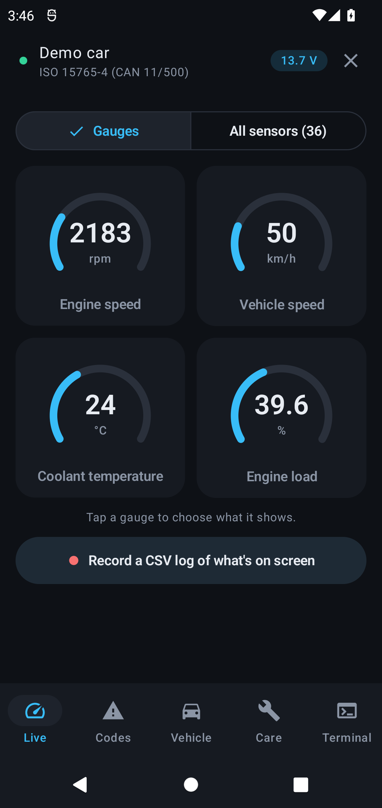
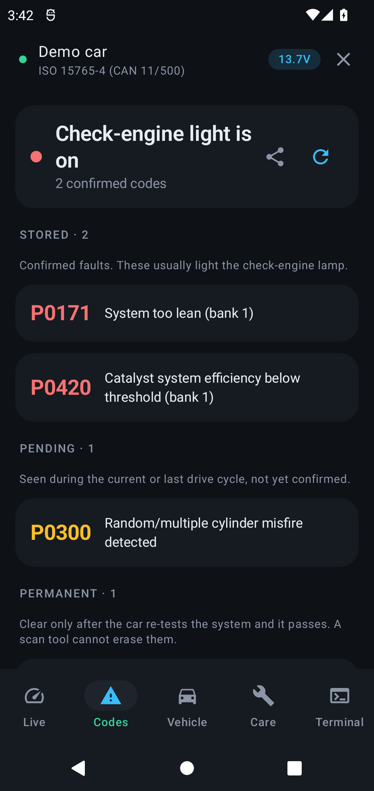
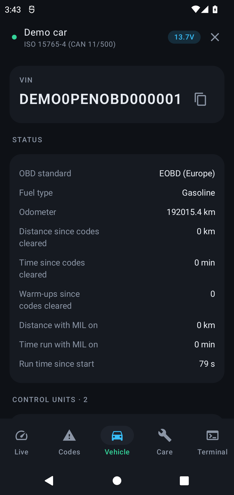
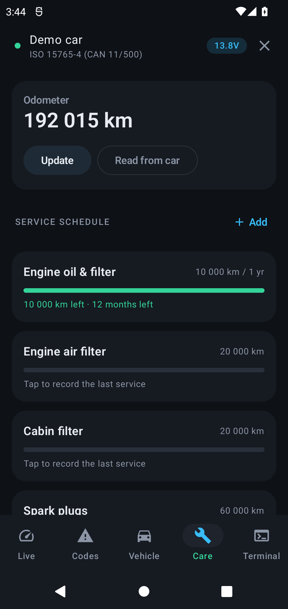
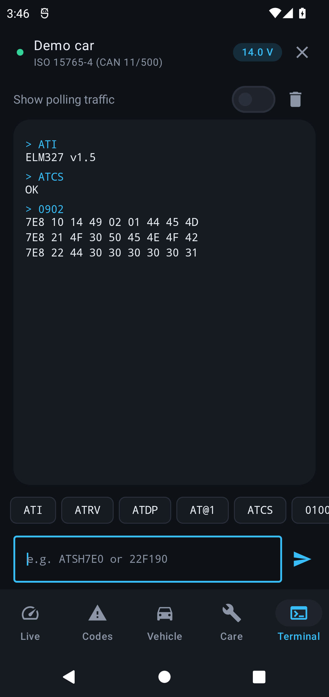

# OpenOBD

A free, minimal Android app for ELM327 Bluetooth OBD-II adapters such as the **Veepeak OBDCheck BLE / BLE+**. Read and clear check-engine codes, watch live engine data, check emissions readiness, and keep a simple service schedule.

| Live | Codes | Vehicle | Care | Terminal |
|---|---|---|---|---|
|  |  |  |  |  |

**No network permission, no account, no analytics, no ads.** Everything stays on the phone. CI fails any build that adds `INTERNET`. Licensed under the [GPL-3.0](LICENSE).

## What it does

Everything a generic ELM327 adapter exposes over standard OBD-II (SAE J1979):

- **Live** — gauges you choose, plus every sensor the car reports (service $01, about 100 standard PIDs decoded; unknown ones shown raw). Record what is on screen to CSV.
- **Codes** — stored ($03), pending ($07) and permanent ($0A) trouble codes with plain-language descriptions, the freeze frame ($02), emissions readiness since clear and for this drive cycle, and a guarded **clear codes** ($04). Share a text report with your mechanic.
- **Vehicle** — VIN, every control unit's name, calibration IDs and CVNs ($09), the car's own monitor test results with pass/fail limits ($06), odometer and distance/time since codes were cleared. Adapter details and an **adapter check**: which ELM327 commands it really supports, version by version from v1.0 to v2.2, so clones that claim a version they do not implement show up. Protocol choice, metric or imperial units.
- **Care** — a service schedule by distance and time (oil, filters, plugs, brake fluid, coolant, or your own). The odometer can be read from the car where it reports one.
- **Terminal** — send any AT or OBD command straight to the adapter, e.g. `ATSH7E0` then `22F190` for manufacturer-specific data. The app restores its adapter settings afterwards.
- **Demo** — no adapter? "Try the demo" runs a simulated car.

It does **not** do what the hardware cannot do generically: ABS/airbag/body modules, coding, service-light resets or active tests. See [docs/REVIEW.md](docs/REVIEW.md) for the limits, from Veepeak's own manual.

## Connect

1. Plug the adapter in. Its blue light turns on.
2. Switch the ignition on. The engine can stay off.
3. Open OpenOBD, allow **Nearby devices**, and tap the adapter under *Nearby · Bluetooth LE*. Bluetooth LE needs no pairing.

If the adapter connects but the car does not answer, *Try each protocol* tests the nine OBD-II protocols one by one and keeps the one that works. If none answers, the car does not speak standard OBD-II: some diesels built before EOBD (2004 in the EU), such as Peugeot and Citroën HDi, only speak the maker's own protocol.

Adapters that only speak Classic Bluetooth must be paired in Android's Bluetooth settings first (Veepeak PIN: `1234`); they then appear under *Paired · Bluetooth Classic*. The adapter serves one app at a time, so close other OBD apps.

Works on Android 6.0 (API 23) and newer, phones, tablets and landscape head units.

## Install

Download `OpenOBD-<version>.apk` from the [Releases](../../releases) page and open it on the phone (allow installing from your browser or file manager when Android asks). Or build it (below) and install with:

```bash
adb install -r app/build/outputs/apk/release/app-release.apk
```

Release APKs are signed with this certificate (SHA-256):

```
A8:18:76:4B:16:51:62:3B:25:9D:8F:49:18:A5:D5:DA:B6:38:C1:1C:A7:0A:4E:DC:4C:AE:65:F2:0B:AC:83:7B
```

An APK you build yourself is signed with your debug key instead, so Android will not install it over a release (or the other way round) without uninstalling first.

## Build

Needs Java 17+ and an Android SDK with **platform `android-37.0`** and **build-tools `37.0.0`**. That is only the compile SDK; `targetSdk` is 35 and `minSdk` is 23.

```bash
sdkmanager "platforms;android-37.0" "build-tools;37.0.0"
```
```bash
ANDROID_HOME=$HOME/Android/Sdk ./gradlew testDebugUnitTest assembleRelease
```

The release APK (minified, about 1.6 MB) lands in `app/build/outputs/apk/release/`. Every plugin and library version is pinned in [`gradle/libs.versions.toml`](gradle/libs.versions.toml).

The tests run the whole stack (ISO-TP framing, the ELM327 link and every OBD service) against the simulated adapter in [`DemoTransport.kt`](app/src/main/java/io/github/foadsf/openobd/elm/DemoTransport.kt).

### Signing

Release builds you make yourself are signed with the debug key so they install directly; F-Droid signs with its own key. If a `debug.keystore` (alias `androiddebugkey`, passwords `android`) sits next to `settings.gradle.kts`, it is used, so builds from different machines can update each other. It is gitignored: **never commit a signing key.**

GitHub releases are signed with the maintainer's key. Its location and passwords live in a properties file outside the repo (`storeFile`, `storePassword`, `keyAlias`, `keyPassword`); the Gradle property `openobd.signing`, set in `~/.gradle/gradle.properties`, points to it.

## How it is built

| Path | What |
|---|---|
| [`elm/`](app/src/main/java/io/github/foadsf/openobd/elm) | Bluetooth LE and Classic transports, the ELM327 command link, frame parsing, the demo simulator |
| [`obd/`](app/src/main/java/io/github/foadsf/openobd/obd) | SAE J1979 services, PID decoders, DTCs, readiness and monitor tests |
| [`ui/`](app/src/main/java/io/github/foadsf/openobd/ui) | Jetpack Compose screens |

Kotlin, Jetpack Compose and Material 3. No other dependencies.

## Contributing

Issues and pull requests are welcome. See [CONTRIBUTING.md](CONTRIBUTING.md). Reports from real cars and adapters are especially useful: say the car, model year, adapter, and what the *Vehicle › Adapter* card shows.

OpenOBD is not affiliated with Veepeak. Product names are their owners' trademarks.
